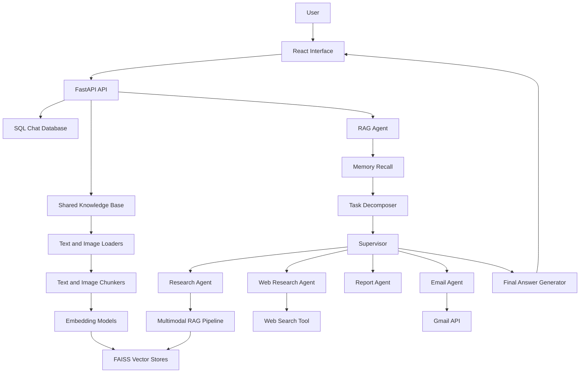
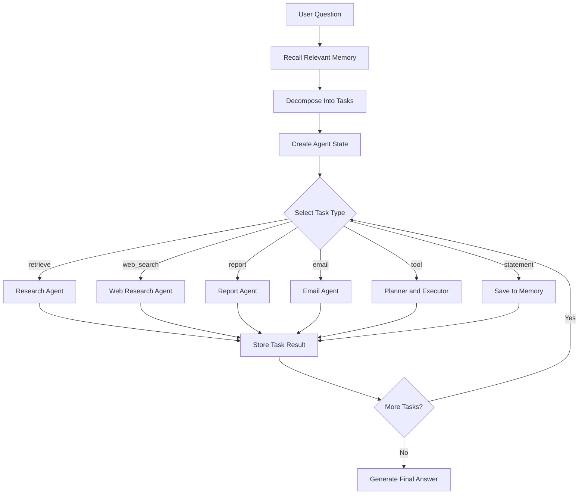

# Enterprise Multimodal Multi-Agent RAG

An end-to-end AI assistant that combines multimodal RAG, long-term memory, specialized agents, external tools, real-time streaming, and persistent chat history.

The system can search uploaded documents and images, perform web research, generate reports, execute calculations, retrieve stored memories, and send emails through Gmail.

---

## 1. Key Features

- Upload multiple documents and images into one shared knowledge base.
- Supports PDF, DOCX, TXT, PNG, JPG, JPEG, and WebP files.
- Text and image retrieval using separate embedding models and FAISS indexes.
- Multimodal question answering using text and vision models.
- Multi-agent task execution with dependency-aware task context.
- Specialized agents for:
  - Document research
  - Web research
  - Report generation
  - Email delivery
- Long-term semantic memory with persistent FAISS storage.
- External tools for:
  - Web search
  - Calculations
  - Date and time
  - Gmail email delivery
- Real-time agent progress and final-answer streaming.
- Persistent conversations using SQL.
- Multiple conversations with create, select, and delete operations.
- Stop-generation support from the React interface.
- Per-stage and total execution-time measurements.
- Docker support for the backend and frontend.
- Ollama integration for local text and vision models.
- OpenAI model integration for reasoning tasks.

---

## 2. Architecture



### Main Layers

| Layer | Responsibility |
|---|---|
| React frontend | Chat interface, uploads, streaming progress, conversation management |
| FastAPI backend | API routes, startup lifecycle, streaming responses |
| RAG pipeline | Retrieval, prompt construction, text or vision generation |
| Knowledge base | Shared document registry and persistent vector stores |
| Agent system | Decomposition, routing, execution, reflection, final answer |
| Memory system | Semantic storage and recall of user information |
| SQL database | Persistent conversations and messages |
| Tools | Web search, calculator, date/time, and Gmail |
| Observability | Stage-level and total execution-time tracking |

---

## 3. Technology Stack

### Backend

- Python 3.11
- FastAPI
- Uvicorn
- FAISS
- Sentence Transformers
- Ollama
- OpenAI API
- Gmail API and Google OAuth 2.0
- SQL database
- Pytest

### Frontend

- React
- Vite
- JavaScript
- Fetch API
- Streaming responses
- Nginx for Docker deployment

### AI Models

| Purpose | Model |
|---|---|
| Reasoning and agent decisions | OpenAI reasoning model |
| Text RAG generation | `qwen2.5:3b` through Ollama |
| Vision generation | `qwen2.5vl:3b` through Ollama |
| Text embeddings | `BAAI/bge-small-en-v1.5` |
| Image embeddings | `sentence-transformers/clip-ViT-B-32` |

### Infrastructure

- Docker
- Docker Compose
- Docker Desktop with WSL 2
- Local Ollama server
- Bind-mounted persistent data

---

## 4. Multi-Agent Flow



The execution process is:

1. Recall relevant long-term memories.
2. Decompose the user request into ordered tasks.
3. Create a shared `AgentState`.
4. Resolve task dependencies.
5. Route each task to the appropriate specialized agent.
6. Pass completed task results to dependent tasks through `TaskContext`.
7. Retry incomplete legacy tasks within the configured iteration limit.
8. Generate and stream a natural final answer.
9. Store the user and assistant messages in SQL.

### Supported Task Types

| Task type | Handler |
|---|---|
| `retrieve` | Research Agent |
| `web_search` | Web Research Agent |
| `report` | Report Agent |
| `email` | Email Agent |
| `tool` | Planner and Executor |
| `statement` | Memory Manager |

---

## 5. Running Locally

### Prerequisites

Install:

- Python 3.11
- Node.js and npm
- Ollama
- Git

Pull the required Ollama models:

```powershell
ollama pull qwen2.5:3b
ollama pull qwen2.5vl:3b
```

Ensure Ollama is running:

```powershell
ollama serve
```

### Backend

From the project root, create and activate a virtual environment:

```powershell
python -m venv env4
env4\Scripts\Activate.ps1
```

Install the dependencies:

```powershell
pip install -r requirements.txt
```

Create the `.env` file and configure the required credentials.

Start the backend:

```powershell
uvicorn api.app:app --reload --host 127.0.0.1 --port 8000
```

Backend documentation:

```text
http://127.0.0.1:8000/docs
```

### Frontend

Open a second terminal:

```powershell
cd frontend
npm install
npm run dev
```

Open:

```text
http://127.0.0.1:5173
```

---

## 6. Running With Docker Compose

### Prerequisites

- Docker Desktop
- WSL 2
- Ollama running on the Windows host

Verify Docker:

```powershell
docker info
docker compose version
```

Build the application:

```powershell
docker compose build
```

Start all services:

```powershell
docker compose up -d
```

Check their status:

```powershell
docker compose ps
```

Follow backend startup logs:

```powershell
docker compose logs -f backend
```

Wait until the following message appears:

```text
Application startup complete.
```

Open the frontend:

```text
http://127.0.0.1:3000
```

Open the backend documentation:

```text
http://127.0.0.1:8000/docs
```

Stop the application:

```powershell
docker compose down
```

Rebuild after code or dependency changes:

```powershell
docker compose up -d --build
```

Recreate only the backend after changing its volumes or environment:

```powershell
docker compose up -d --force-recreate backend
```

### Ollama From Docker

The backend container communicates with Ollama on Windows through:

```env
OLLAMA_HOST=http://host.docker.internal:11434
```

Ollama is not bundled into the application containers.

---

## 7. Environment Variables

Create `.env` in the project root:

```env
OPENAI_API_KEY=your_openai_api_key
HF_TOKEN=your_optional_huggingface_token
OLLAMA_HOST=http://127.0.0.1:11434
```

When running the backend inside Docker, Compose should override the Ollama address:

```yaml
environment:
  OLLAMA_HOST: http://host.docker.internal:11434
```

### Gmail OAuth Files

Email delivery requires:

```text
credentials.json
token.json
```

- `credentials.json` contains the Google OAuth client configuration.
- `token.json` is generated after completing OAuth authorization.
- Generate `token.json` locally before using email delivery in Docker.
- Do not start an interactive OAuth browser flow inside the container.

Mount the files into the backend container:

```yaml
volumes:
  - ./data:/app/data
  - ./credentials.json:/app/credentials.json:ro
  - ./token.json:/app/token.json
```

Never commit secrets. Add these entries to `.gitignore`:

```gitignore
.env
credentials.json
token.json
token.expired*.json
```

An `.env.example` file may safely contain:

```env
OPENAI_API_KEY=
HF_TOKEN=
OLLAMA_HOST=http://host.docker.internal:11434
```

---

## 8. Uploading Multiple Documents and Images

The interface supports selecting and uploading several files in one request.

Supported formats:

```text
.pdf
.docx
.txt
.png
.jpg
.jpeg
.webp
```

All uploaded content is appended to one shared knowledge base:

- Text chunks are embedded and stored in the text FAISS index.
- Image chunks are embedded and stored in the image FAISS index.
- Existing vectors are preserved when new files are added.
- Questions can retrieve information from all uploaded files.

Example upload response:

```json
{
  "success": true,
  "uploaded_count": 3,
  "knowledge_base": {
    "document_count": 3,
    "text_chunk_count": 6,
    "image_chunk_count": 2
  }
}
```

Example API request:

```powershell
curl.exe -X POST `
  "http://127.0.0.1:8000/documents/upload" `
  -F "files=@C:\path\document.pdf" `
  -F "files=@C:\path\apple.jpg" `
  -F "files=@C:\path\cat.jpg"
```

The exact form field accepted by the endpoint should match the current API implementation. The React interface already sends the files using the configured upload field.

---

## 9. Example Questions

### Document Retrieval

```text
What is Ali's LinkedIn link?
```

```text
Find Ali's GitHub profile in the uploaded document.
```

```text
What is Ali's phone number?
```

```text
What projects did Ali build?
```

### Image Understanding

```text
What color is the apple shown in the uploaded image?
```

```text
What is the color of the cat shown in the image?
```

### Long-Term Memory

```text
My favorite food is pasta.
```

Then ask:

```text
What is my favorite food?
```

### Tools

```text
What is 3572 multiplied by 2?
```

```text
What is the current date and time?
```

### Multi-Agent Workflow

```text
Find the latest stable Python version and its main improvements,
create a short report, find Ali's email in the uploaded document,
and send the report to him with the subject "Python Version Report".
```

This request exercises:

1. Web Research Agent
2. Report Agent
3. Research Agent
4. Email Agent
5. Dependency-aware state passing

---

## 10. Running Tests

Run the full suite from the project root:

```powershell
pytest
```

Run with detailed output:

```powershell
pytest -v
```

Run a specific test module:

```powershell
pytest tests/pipeline/test_multimodal_rag_pipeline.py -v
```

Run the performance tests:

```powershell
pytest tests/pipeline/test_rag_pipeline_performance.py -v
```

Recommended final verification:

```powershell
pytest -v --tb=short
```

The test suite covers:

- Document loading and chunking
- Text and image embedding
- FAISS retrieval
- Multimodal prompt construction
- Text and vision generation routing
- Task decomposition
- Planning and tool selection
- Specialized agents
- Dependent task context
- Streaming events
- SQL conversation persistence
- Performance measurements

External integrations such as live OpenAI, web search, Gmail, and Ollama may require separate integration tests and valid credentials.

---

## 11. Performance Measurements

The application measures total execution time and individual pipeline stages.

Example RAG measurement:

```json
{
  "total_ms": 2007.583,
  "finished": true,
  "stages": {
    "multimodal_retrieval": {
      "total_ms": 71.466,
      "count": 1,
      "average_ms": 71.466
    },
    "multimodal_prompt_building": {
      "total_ms": 0.034,
      "count": 1,
      "average_ms": 0.034
    },
    "vision_llm_generation": {
      "total_ms": 1936.03,
      "count": 1,
      "average_ms": 1936.03
    }
  }
}
```

The complete agent also measures:

- Memory recall
- Task decomposition
- Supervisor execution
- Final-answer generation
- Total request time

The frontend displays the total duration when execution finishes:

```text
Done in 10.7 seconds.
```

Observed results show that retrieval and prompt construction are fast, while model generation and repeated reasoning calls account for most of the response time.

Performance depends on:

- CPU and available memory
- Selected Ollama model
- Number and size of uploaded files
- Number of generated tasks
- OpenAI and web-search network latency
- Whether models are already loaded
- Whether Hugging Face models are cached

---

## 12. Screenshots and Demo Video

Create a `docs` directory:

```text
docs/
├── architecture.png
├── chat-document-example.png
├── chat-image-example.png
├── multi-agent-email-example.png
└── demo.mp4
```

Add screenshots to the README:

```markdown
### Document Retrieval


### Image Question Answering


### Multi-Agent Email Workflow


```

For the demo video, show this sequence:

1. Start the application using Docker Compose.
2. Upload one PDF and two images.
3. Ask a question about the PDF.
4. Ask a visual question about each image.
5. Run a web-research and report task.
6. Retrieve the recipient's email from the PDF.
7. Send the generated report.
8. Show the received Gmail message.
9. Refresh the page to demonstrate SQL chat persistence.
10. Display the completed task timeline and execution time.

A short demo of approximately two to four minutes is sufficient.

---

## 13. Current Limitations and Future Improvements

### Current Limitations

- Ollama must run separately on the host machine.
- Initial startup may be slow while embedding models are downloaded or loaded.
- Local model generation is CPU-dependent and may be slow.
- Gmail requires manual OAuth authorization.
- Uploaded knowledge-base vectors may need rebuilding after a complete container reset unless FAISS persistence is enabled and mounted.
- Retrieval uses fixed `top_k` values.
- A low similarity threshold may include weakly related chunks.
- The agent performs several LLM calls for memory filtering, decomposition, execution, and final generation.
- Uploaded documents are treated as knowledge, but stronger prompt-injection protection is still desirable.
- Email recipient verification currently depends on the extracted task context.
- The application currently targets a single-user local deployment.
- Authentication, authorization, and user isolation are not yet implemented.

### Future Improvements

- Persist both text and image FAISS indexes automatically.
- Restore the knowledge base during application startup.
- Add document deletion and index rebuilding.
- Add hybrid retrieval using semantic and keyword search.
- Add reranking after vector retrieval.
- Select `top_k` dynamically based on the question.
- Cache repeated retrieval and model responses.
- Reduce unnecessary memory-relevance LLM calls.
- Add stronger prompt-injection detection for uploaded documents.
- Require confirmation before sending sensitive emails.
- Add user authentication and isolated knowledge bases.
- Add structured citations to source files and pages.
- Add evaluation datasets for retrieval and end-to-end agent quality.
- Add production monitoring, tracing, and error reporting.
- Add CI/CD using GitHub Actions.
- Deploy the application to a cloud platform.
- Add voice input and speech output.